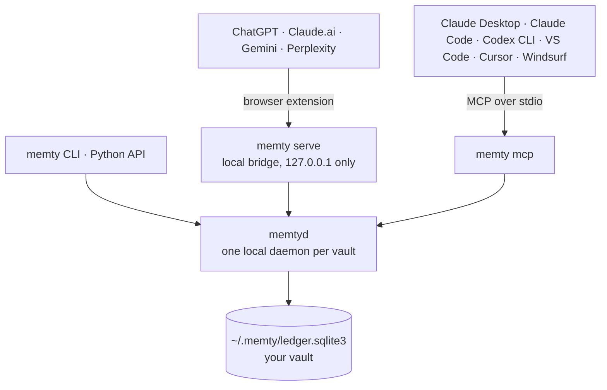
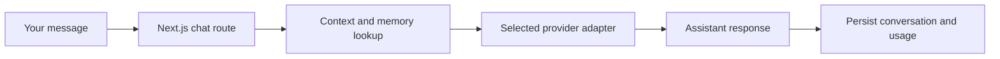

<div align="center">

<picture>
  <source media="(prefers-color-scheme: dark)" srcset="assets/memty-wordmark-dark.png">
  
</picture>

### Your AI memory, owned by you.

One private, local memory vault for every AI assistant you use: ChatGPT, Claude, Gemini, Perplexity, Cursor, and any MCP client.

[](https://pypi.org/project/memty/)
[](https://pypi.org/project/memty/)
[](LICENSE)

[Website](https://memtylabs.github.io/memty/) · [Quick start](#quick-start) · [How it works](#how-it-works) · [Package docs](memty/README.md) · [Changelog](memty/CHANGELOG.md)

</div>

---

Memty keeps the facts, decisions, and preferences you share with AI in **one SQLite file on your own computer**, and brings that memory to whichever assistant you open next. You stop repeating yourself, your memory isn't locked inside one company's product, and you can see, edit, and delete every fact.

- **Local-first:** the vault lives at `~/.memty/ledger.sqlite3`. There's no account, no cloud sync, and no telemetry.
- **Works everywhere:** a browser extension for chat websites, MCP for desktop and coding tools, the clipboard for anything else, and a Python API.
- **You're in control:** facts saved from chats are proposals you approve. You can edit, mark private, or permanently delete anything.
- **Private by design:** private facts reach cloud AIs only as `[private]`, and secret facts never leave your machine.

This repository contains two things:

| | What it is | Status |
| --- | --- | --- |
| **The `memty` package** | The local memory vault, the `memtyd` daemon, CLI, MCP server, and browser bridge and extension | [On PyPI](https://pypi.org/project/memty/), v0.2.0 |
| **The web workspace** | A multi-provider AI chat app (Next.js, Express, and MongoDB) | Run it yourself; see [Web workspace](#web-workspace) |

> **Status:** Memty is in alpha (0.x). The vault's storage format is stable and covered by tests; commands and options may still change between minor versions.

## Token Burn Benchmark

In three live runs of the same synthetic five-turn architecture handoff between Claude Haiku 5.5 and Gemini 2.5 Flash, the selected Memty context used fewer provider-reported input tokens:

| Context supplied | Average input tokens per run | Reduction with Memty | Exact answers across three runs |
| --- | ---: | ---: | ---: |
| Full document replay | 4,663 | 61.1% | 27/30 |
| Simulated retrieval: curated snippets and illustrative tool definitions | 3,128.7 | 42.0% | 27/30 |
| Selected Memty context | 1,816 | — | 30/30 |

These are encouraging results for **one synthetic fixture**, not proof of universal recall or savings against a real RAG/MCP product. The retrieval baseline did not call a retrieval service, and Memty's facts were prepared in advance. [See every run, methodology, and reproducibility instructions](benchmarks/token_burn/README.md).

<a id="quick-start"></a>
## 🚀 Quick start

You need Python 3.10 or newer on Windows, macOS, or Linux.

```shell
pip install memty

memty serve --autostart   # start the local bridge now and at every login (one time)
memty extension --open    # install the browser extension folder and open it
memty connect             # optional: Claude Desktop, Claude Code, Cursor, Windsurf
```

On Windows, if `memty` is not recognized, run `py -m pip install --upgrade memty`
followed by `py -m memty`. You can replace `memty` with `py -m memty` in the
commands above. See [Windows troubleshooting](memty/README.md#windows-memty-is-not-recognized)
for PATH and virtual environment help.

Load the extension once: open `chrome://extensions` (or `edge://extensions`), turn on **Developer mode**, click **Load unpacked**, and choose the folder that opened. It pairs itself with Memty, so there's no token to copy.

Then, in ChatGPT, Claude.ai, Gemini, or Perplexity:

- **Select text → ＋ Save to Memty.** Memty proposes short facts. You edit or untick them, then save.
- **⚡ Memty (Alt+M).** Choose a saved context, newest first. Its numbered facts go into the message box for you to check before sending:

  ```
  [Memty context]
  1. Database: PostgreSQL 16 on Neon
  2. Deploy target: Fly.io
  3. Client: [private]
  [/Memty]
  ```

- **☰ Your facts.** View, search, edit, add, delete, or mark facts private.

From the terminal:

```shell
memty remember work.project editor "VS Code"
memty recall "Which editor do I use?" --namespace work.project
memty clip work.project        # copy your facts for any AI app
```

<a id="how-it-works"></a>
## 🧭 How it works



1. **Atomic facts:** memory is stored as small `namespace.slot = value` facts of at most 40 tokens, for example `work.project.editor = "VS Code"`. CLI updates keep a slot's history; each reviewed browser save creates its own context.
2. **Namespaces** such as `work.project` and `personal` keep contexts apart. A chat only gets the namespace you choose.
3. **The compiler** builds a small capsule for each request: newest facts first, or the most relevant ones for a question, always under a hard token budget.
4. **The privacy gate** checks every capsule:
   - **PUBLIC** facts are shared.
   - **INTERNAL** facts only go to local or trusted providers.
   - **CONFIDENTIAL** facts appear as `[private]`.
   - **SECRET** facts stop the request.
5. **You decide:** automatic extraction can't overwrite facts you confirmed or bring back facts you deleted.

Picking facts from a chat uses local rules by default: prose, bullets, and `Key: value` lines are considered; long passages are split into related parts for review. Questions, headings, and raw code are skipped, and code blocks may become one-line summaries. Set `MEMTY_OLLAMA_MODEL` to use a local model for extraction and summaries. Review the proposals against the original text before saving.

## 🔒 Privacy and data

| What | Where |
| --- | --- |
| Your facts | `~/.memty/ledger.sqlite3`, a single file on your disk |
| Extension pairing | `ledger.sqlite3.web-token` and `.web-paired.json`, beside the vault (owner-only) |
| Browser storage | Settings only (port, token, namespace, pill position), never facts |
| Cloud | Nothing. Facts leave your computer only when you press Send in a chat. |

How the local bridge is protected:

- It listens only on `127.0.0.1`.
- Every request needs a token.
- Web pages are refused, and only extensions you approved can connect (`memty pair` adds another browser).
- It checks the `Host` header, which blocks DNS rebinding.

The vault file itself is **not encrypted**, so it relies on your computer account's protection. Keep it out of synced folders such as OneDrive or Dropbox unless you want it uploaded.

## 🧰 Commands

| Command | What it does |
| --- | --- |
| `memty serve --autostart` | Start the browser bridge now and at every login (`--no-autostart` to undo) |
| `memty daemon` | Start the shared vault daemon and browser bridge for the current vault |
| `memty extension` | Install or update the browser extension folder |
| `memty pair` | Connect another browser or a reinstalled extension (two-minute window) |
| `memty connect` | Connect Claude Desktop, Claude Code, Codex CLI, VS Code, Cursor, and Windsurf through supported installers or guided steps |
| `memty remember` · `recall` · `forget` | Save, compile, or permanently delete facts |
| `memty list` · `history` · `stats` | Inspect facts, versions, and the vault |
| `memty clip NS` | Copy a namespace's facts to the clipboard |
| `memty summary` · `rule` · `rules` | Namespace summaries and logical rules |
| `memty migrate PATH` | Import from an earlier Memty vault |
| `memtyd status` · `start` · `stop` | Control the shared background daemon |

The full reference, Python API, and security model are in the [package README](memty/README.md).

<a id="web-workspace"></a>
## 🖥️ Web workspace

The repository also contains a multi-provider AI chat workspace. Its account conversations and MongoDB memory are **separate from the local vault** and don't sync with it today.


The browser talks to the Next.js app. Its chat route calls the selected model adapter and uses a private proxy to reach the Express service for account sessions and saved data.



### Run it locally

You need Node.js 20.9 or later, MongoDB for sign-in and saved data, and credentials for the providers you want to use.

```powershell
npm install
cd backend
npm install
cd ..
Copy-Item .env.example .env
Copy-Item backend/.env.example backend/.env
```

Add your MongoDB URI and provider keys, keep these files private, then start two terminals from the repository root:

```powershell
npm run dev              # Terminal 1: Next.js app on http://localhost:3001
cd backend; npm run dev  # Terminal 2: Express API on port 3002
```

Without provider credentials, those models are shown as unavailable.

### Docker Compose

Compose starts the frontend, backend, and optional Memty HTTP vault service; MongoDB stays external. Before you start it:

1. Create the environment files as above.
2. In `backend/.env`, set a reachable `MONGO_URI` and a stable `SESSION_SECRET`.
3. In `.env`, replace the example `MEMORY_VAULT_API_TOKEN` with a random secret of at least 32 characters.

```powershell
docker compose up --build
```

Open <http://localhost:3001>. Stop the stack with `Ctrl+C` or `docker compose down`. Compose doesn't migrate MongoDB memories into the local vault.

### Configuration

The root `.env` configures Next.js and the model providers. `backend/.env` configures MongoDB and the Express service; the backend loads the root file first, then applies its own values.

| Setting | Service | Purpose |
| --- | --- | --- |
| `GEMINI_API_KEY`, `CLAUDE_API_KEY`, `GROK_API_KEY`, `KIMI_API_KEY` | Frontend and/or backend | Enable the corresponding models |
| `OPEN_ROUTER_OPEN_API_KEYS`, `OPEN_ROUTER_API_KEY` | Frontend | Enable OpenRouter-backed models |
| `MONGO_URI`, `MONGO_DATABASE`, `MEMORY_DATABASE` | Backend | Account and memory databases |
| `SESSION_SECRET` | Backend | Signs sessions; use a stable, high-entropy value in production |
| `PROXY_TARGET` | Frontend | Backend URL (default `http://localhost:3002`) |
| `MEMORY_VAULT_API_URL`, `MEMORY_VAULT_API_TOKEN` | Backend and vault | Connect the backend to the optional vault API |

See [`.env.example`](.env.example) and [`backend/.env.example`](backend/.env.example) for every option. Never commit real credentials or paste them into issues.

For semantic memory retrieval, create the Atlas Search vector index on `Memory.user_memories` from [`backend/memory-vector-index.json`](backend/memory-vector-index.json). It expects 768-dimensional cosine vectors and filters on `userId` and `status`. Without the index or an embedding service, retrieval falls back to lexical and recency scoring.

## 🗺️ Project map

| Path | What lives here |
| --- | --- |
| [`memty/`](memty/README.md) | The Python package, one folder per job ([code layout](memty/README.md#code-layout)): `vault/`, `context/`, `extraction/`, `trust/`, `runtime/`, `integrations/` |
| [`memty/integrations/browser/extension/`](memty/integrations/browser/extension/README.md) | The Memty Bridge browser extension (shipped inside the package) |
| [`memoryport/`](memoryport/README.md) | The older temporal vault, kept for the `memory-vault` Docker service (`memty-api`) |
| [`tests/`](tests/) | Package tests (`python -m pytest tests`) |
| [`GitPage/`](GitPage/index.html) | The product website, deployed to [GitHub Pages](https://memtylabs.github.io/memty/) on every change to `main` |
| [`app/`](app/README.md) | Web workspace: Next.js pages, API routes, and chat orchestration |
| [`backend/`](backend/README.md) | Web workspace: Express routes, authentication, and MongoDB models |
| [`providers/`](providers/README.md) | Web workspace: model registry, provider adapters, and fallbacks |
| [`components/`](components/legacy-page.tsx) · [`lib/`](lib/legacy-markup.ts) · [`public/`](public/) · [`templates/`](templates/) · [`static/`](static/) | Shared UI pieces, legacy markup, and static assets |
| [`assets/`](assets/) | Logos and artwork |
| [`scripts/`](scripts/) | Helper scripts, including the extension icon generator |
| [`compose.yaml`](compose.yaml) · [`Dockerfile`](Dockerfile) · [`Dockerfile.vault`](Dockerfile.vault) | Container builds and the Compose stack |

## 🛣️ Progress and roadmap

| Milestone | Status |
| --- | --- |
| **Week 1:** atomic vault, versioning, permanent deletion, privacy gate, token-bounded compiler | ✅ Shipped |
| **Week 2:** shared `memtyd` daemon, MCP server, safe `memty connect` | ✅ Shipped |
| **Week 3:** browser extension, fact manager, readable capsules, local extraction, pairing, autostart, PyPI v0.2.0 | ✅ Shipped |
| Chrome Web Store listing (one-click install) | ⏭️ Next |
| Trust control plane: `memty scan`, agent proposal inbox, context receipts and `memty report` | 🔨 Built, unreleased |
| [Synthetic token payload benchmark](benchmarks/token_burn/README.md) | Available; real-provider and product comparisons remain to be measured |

See the [changelog](memty/CHANGELOG.md) for details.

## ⚠️ Known limitations

- **The extension isn't on the Chrome Web Store yet.** It's loaded as an unpacked folder with Developer mode, in Chrome, Edge, or Brave.
- **The vault is plain SQLite on disk.** There's no built-in encryption or sync.
- **Fact extraction reads the shape of text, not its meaning.** That's why every proposal is reviewed before saving.
- **Chat sites change often,** so the extension's page detection is best effort. Selecting text always works.
- **The web workspace isn't ready for a public launch as-is:**
  - Chat responses aren't streamed.
  - Request limits are per process.
  - Launching publicly needs account deletion and retention, abuse controls, monitoring, backups, and a security review.
  - Model availability and prices depend on the providers.
  - Cost figures are estimates, not billing records.

Review the [Privacy Notice](app/privacy/page.tsx) and [Terms](app/terms/page.tsx) against your deployment before releasing the web workspace.

## 📚 Documentation

- [Memty package: CLI, Python API, MCP, browser bridge, and security](memty/README.md)
- [Browser extension](memty/integrations/browser/extension/README.md)
- [Changelog](memty/CHANGELOG.md)
- [Web frontend](app/README.md) · [Backend](backend/README.md) · [Memory layers](app/memory/README.md) · [Providers](providers/README.md)
- [Website](https://memtylabs.github.io/memty/)

## 🤝 Contributing

Start with the [contributor guide](CONTRIBUTING.md), pick the guide for the area you're changing, and choose a focused issue. Run `python -m pytest tests` before opening a pull request, and keep credentials and personal data out of commits and issues.

## 📄 License

[MIT](LICENSE)
